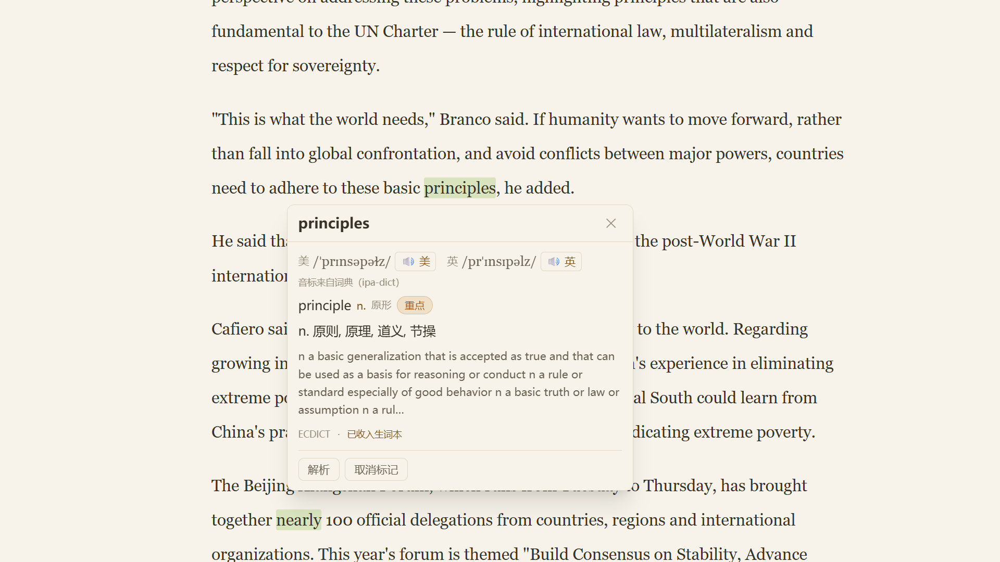
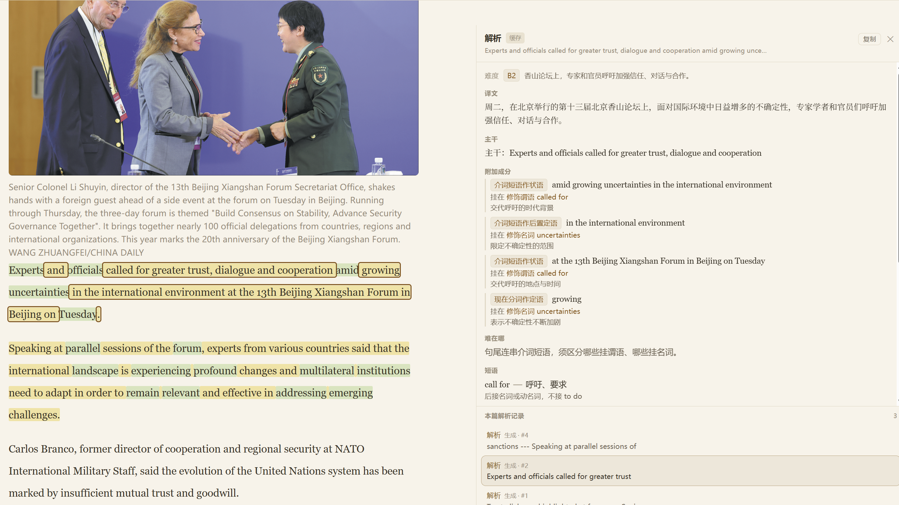
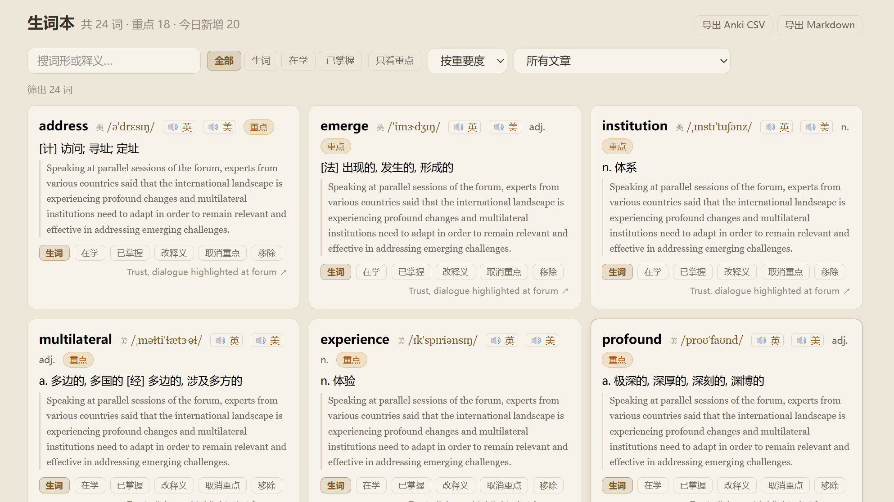

# EnglishReadUp · 英语阅读提升

> 给「读外刊学英语」的人一条闭环：抓文章 → 精读 → 划词 → 拆长难句 → 生词本 → 间隔复习。

**EnglishReadUp** 是一个自托管的英语精读工具：粘一个文章 URL，它把正文和图片抓下来存到本地；
你在内置阅读器里精读，查过的词、解析过的句子自动沉淀成生词本与语法清单，
最后按遗忘曲线复习、按需导出到 Anki 或 Markdown。数据全在本机，没有云端账号。

## 为什么做这个

我在读英文文章的时候，经常需要翻译工具参与，经常同一个词反复查询，我就在想有没有工具可以把生词、长难句记录下来，后面可以复习。
工具其实很多，但是没有那种完全符合心意的，所以就自己做了一个。可以说是针对我自己量身定制了，如果你也需要，欢迎拿去使用。

目前只对两个站点（sixthtone.com、chinadaily.com.cn）做了文章抓取适配，后续会逐渐适配更多站点。

> 本文档剩下内容全由 AI 生词，不一定对，注意识别

## 功能

### 文章库：粘贴链接，正文与图片抓到本地


- 支持静态站点与客户端渲染站点（后者自动走无头浏览器渲染，约 40 秒）；抓取在后台异步跑，不挡手
- 正文按段落 / 小标题 / 图片 / 图注结构化入库，图片下载到本地 —— **断网也能读**
- 列表上直接看得到字数、图片数、来源，以及**上次读到哪**（「已读 46 分钟」「停在 56%」），点「继续阅读」回到原位
- 每篇可导出 MD / 生词 CSV / 清单，可重抓、可删除；**重抓不会丢已有的学习痕迹**

### 划词：词卡立刻出，英美音标 + 发音 + 自动入册



- 双击或拖选单词，浮层**当场**给出：美 / 英两条音标、词性、中文释义（+ 英文释义）
- **整条查词路径不出网**：音标来自 ipa-dict（现代宽式 IPA、英美双轨、收屈折形式），释义来自 ECDICT 的 340 万词条
- 每条音标后面跟着**它自己的 🔊**（`🔊 英` / `🔊 美`），音频下载到本地后秒播、离线可听
- 变形词回退到原形并标注来源（划 `principles`，音标取自 `principle`）；只划中半个词会**自动吸附成整词**，不会拿半截字母去查
- 这个词**已经自动进了生词本** —— 不需要再点「收藏」

### 长难句：一次【解析】，讲清主干与挂靠



- 拖选句子 → 点【解析】→ 右侧面板**流式吐字**，看到的是一句话在长出来，不是干等转圈
- 产出是一套「主干 → 挂靠」结构：先给句子骨架，再逐条说明每个成分**挂在谁身上、起什么作用**
  （`介词短语作状语 → 挂在谓语 called for · 交代呼吁的地点与时间`），而不是按语法类别堆名词
- 另给「难在哪」「短语」，以及**换个句子也用得上**的语法要点 —— 后者自动进本篇语法清单
- 产出顺序是「译文 → 主干 → 附加成分 → 语法要点」，只想看意思的人等前几秒就够，不必另设「只翻译」按钮
- 划中句子**不点解析就不留任何痕迹**：正文不出高亮，清单不出条目，选错了把浮层关掉即可

### 生词本：划词即入册，例句自带上下文



- 一词一条，带音标、词性、释义和**它被划到时的那句话**；复习时能想起当时的语境
- 按状态（生词 / 在学 / 已掌握）、只看重点、按文章筛（「在这篇里划过」），四种排序
- 释义与批注可以自己改，**你的输入永远不会被词典覆盖**；移除只删这一行，原文高亮与解析记录都不动
- 一键导出 **Anki CSV**（首行就是 `#separator:Comma`，Anki 直接认）或 Markdown

### 间隔复习：到点才考，四档评分


- 卡片正面只有词形、音标、词性 —— 不提前泄露释义；`空格` 翻面，`1~4` 评分（忘了 / 勉强 / 记得 / 太简单）
- 每个评分按钮上写着**下次什么时候再见**，点之前就知道代价
- 新词每天限量 20 个，到期的旧词不设上限（欠的债要还）；顶部预测条显示未来一周的复习量
- 「忘了」在复习阶段只把间隔**折半而不是清零** —— 让人敢点「忘了」，复习数据才不失真
- 暂停某张卡不等于删词：它退出出题队列，但仍留在生词本与检索里

### 还有

- **三组检索**：一次输入，原文正文 / 生词本 / AI 解析记录一起返回，每条都能跳回原文、闪两下定位到那句话
- **单篇汇总**：读完自动汇总本篇生词表 + 语法清单，可导出
- **阅读体验**：light / sepia / dark 三套主题，字号 / 行距 / 栏宽可调，AI 面板宽度可拖，图片点击放大
- **留档与清理**：每次解析都留流水，右栏底部按时间回看；误操作的记录可删除，不影响原文痕迹

## 设计上坚持的几件事

- **学习痕迹与原文结构物理分离** —— 删标注、删生词、重抓文章，三件事互不牵连
- **音标与释义只来自词典，绝不让模型编** —— 宁缺勿假，在代码层保证而不是靠 prompt 自觉
- **每次 AI 调用都留流水** —— 查过的词、解析过的句子都能回看、可全文检索
- **结果进缓存就必须有版本号** —— 改了 prompt 或产出，旧缓存自动失效，不会拿旧答案糊弄

## 快速开始

### 1. 环境要求

| 项 | 要求 |
|---|---|
| Python | 3.11+（实测 3.13）；推荐用 [uv](https://docs.astral.sh/uv/) 建环境 |
| Node.js | 20+（实测 22） |
| 磁盘 | 约 1.5 GB（本地词典库 811 MB + Playwright Chromium ~150 MB + 文章与图片） |
| 网络 | 能访问 `api.deepseek.com`（选段解析）与 `dict.youdao.com`（发音） |

### 2. 后端

```bash
cd backend

uv venv --python 3.13
uv pip install -r requirements.txt
uv run python -m playwright install chromium     # 抓客户端渲染站点要用
```

### 3. 配置

```bash
cd backend
copy .env.example .env        # macOS / Linux: cp .env.example .env
```

至少填一项：

```ini
LLM_API_KEY=sk-xxxxxxxxxxxxxxxxxxxxxxxx
```

不填也能启动：划词查词、发音、阅读、复习都不受影响，只有选段【解析】返回 502。

### 4. 词典库

划词用的 `stardict.db`（约 811 MB）与 `ipa_en_*.txt` 不进版本库，
**服务启动时会自检并在后台自动补齐**（缺哪个下哪个，不堵启动）。
不想自动下载就设 `DICT_AUTODOWNLOAD=false`，改用：

```bash
cd backend
python scripts/fetch_dicts.py            # 装 / 补
python scripts/fetch_dicts.py --verify   # 只体检，不联网
```

### 5. 前端

```bash
cd frontend
npm install
npm run build        # 产物落 frontend/dist，由后端同进程直发
```

> 用 npm，不要用 pnpm（pnpm 11 会把 `@types/react` 装成空目录，`tsc` 报 TS2688）。

### 6. 启动

```bash
cd backend
uv run python -m app.main        # http://127.0.0.1:8010
```

日常只需这一个进程 —— 界面、`/api/*`、`/media/*` 都由它提供。

改前端代码时另开 Vite（热更新，`/api` 与 `/media` 反代到 8010）：

```bash
cd frontend
npm run dev                      # http://127.0.0.1:5173
```

健康检查：<http://127.0.0.1:8010/api/health>，交互式 API 文档：<http://127.0.0.1:8010/docs>。

## 技术栈

| 层 | 选型 |
|---|---|
| 后端 | Python 3.13 + FastAPI + uvicorn |
| 抓取 | httpx（异步）+ Playwright（渲染兜底）+ trafilatura / selectolax |
| 存储 | SQLite + FTS5（单文件、零运维、内置全文检索） |
| 数据校验 | Pydantic v2 |
| LLM | DeepSeek（`deepseek-flash`），httpx 直连 OpenAI 兼容端点 |
| 词典 | ECDICT（释义/词性/考纲标签）+ ipa-dict（英美双音标），只读本地查询 |
| 前端 | React 19 + Vite + TypeScript + Tailwind + TanStack Query |

## 目录结构

```
English/
├── docs/
│   ├── DESIGN.md       # 设计说明书：为什么这么做（唯一权威）
│   ├── USAGE.md        # 使用手册：怎么装、怎么起、怎么用、怎么排查
│   └── images/         # README 用到的功能截图
├── backend/
│   ├── app/            # FastAPI 应用：api/ 路由 + services/ 业务 + schema.sql
│   ├── data/           # 数据库、词典库、图片、音频（不进版本库，可备份可迁移）
│   ├── scripts/        # 维护脚本、抓取命令行、各里程碑验收脚本
│   └── requirements.txt
└── frontend/
    └── src/            # pages / components / lib
```

## 验收脚本

改代码后回归用（都在 `backend/scripts/`，浏览器验收需后端 8010 在跑）：

| 脚本 | 覆盖 |
|---|---|
| `smoke_api.py` | 抓取入库、幂等、删除、进度 |
| `smoke_ai.py` | AI 编排：解析结构、缓存、流水、旧端点 404 |
| `smoke_m4.py` | 生词本 / 语法清单 / 检索 / 导出 |
| `smoke_m5.py` | SRS 调度 / 队列 / 评分 / SSE |
| `smoke_m10.py` | 划词本地化：词条兜底、worth 规则、入册幂等、双口音下载 |
| `smoke_ui*.py` / `smoke_m9.py` | 浏览器端到端（阅读器、划词、清单、复习、标题可划与右栏拖宽） |

```bash
cd backend
python scripts/smoke_m5.py                                        # 后端
python scripts/smoke_ui_m5.py                                     # 浏览器（打 Vite 5173）
FRONT_URL=http://127.0.0.1:8010 python scripts/smoke_ui_m5.py     # 浏览器（打构建产物）
```

## 文档

- [`docs/DESIGN.md`](docs/DESIGN.md) —— 架构、数据模型、抓取策略、AI 编排、
  前端设计、API 契约、里程碑与全部技术决策的理由。**改设计先改它。**
- [`docs/USAGE.md`](docs/USAGE.md) —— 安装、配置、启动、使用流程、
  故障排查、成本与隐私。

## 数据、隐私与版权

- 所有数据（正文、图片、发音音频、痕迹、生词本、复习进度）只存在本机 `backend/data/`，
  备份、迁移拷这一个目录即可。
- 对外请求只有两类：把选中文本发给 DeepSeek 做解析、把单词发给有道取发音。
  **划词查释义完全不出网**；音频下载到本地后播放也不再联网。
- 抓下来的正文与图片**仅限本地个人学习使用**，不要公开分发，保留原文 URL 与来源标注。
